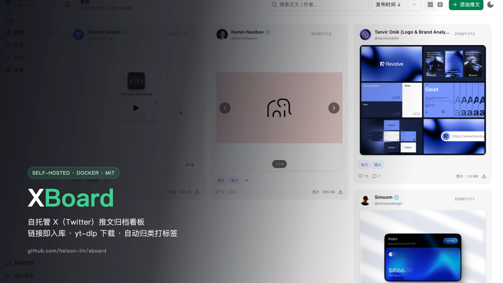
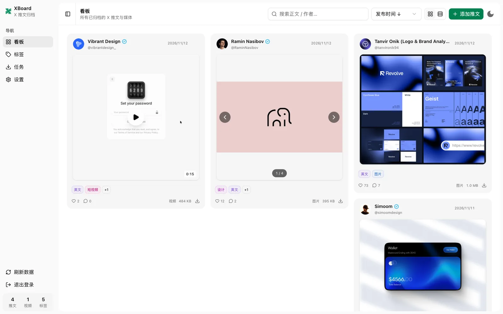
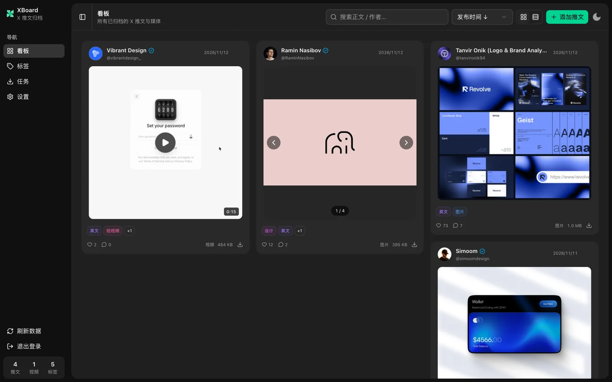
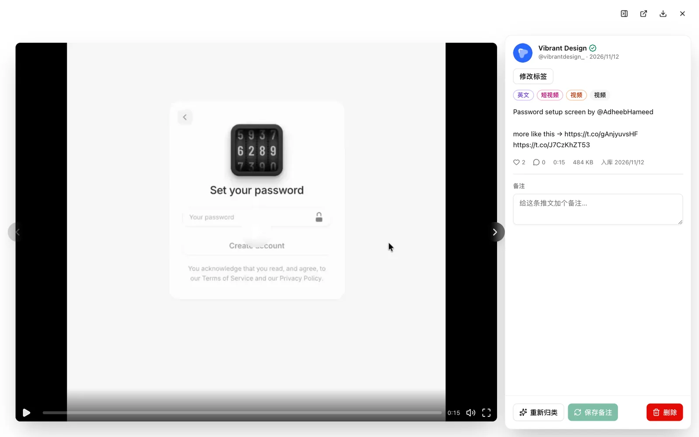
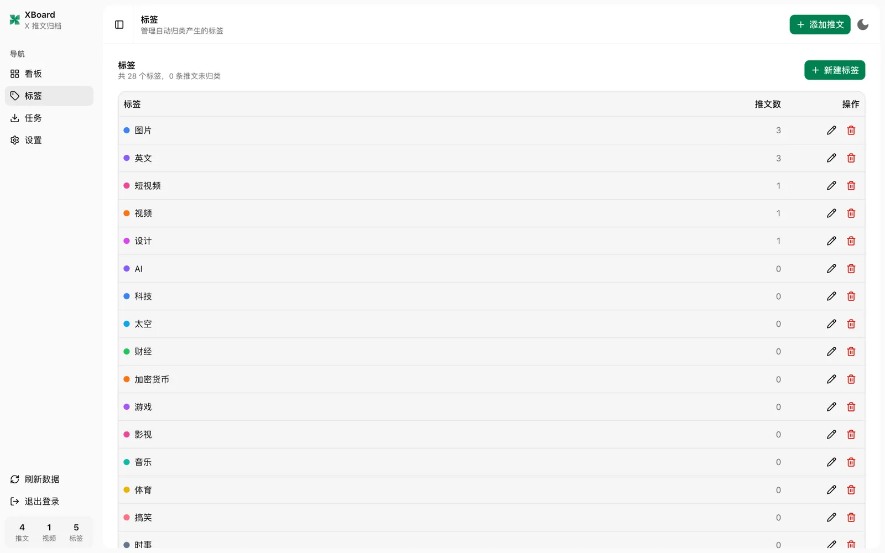
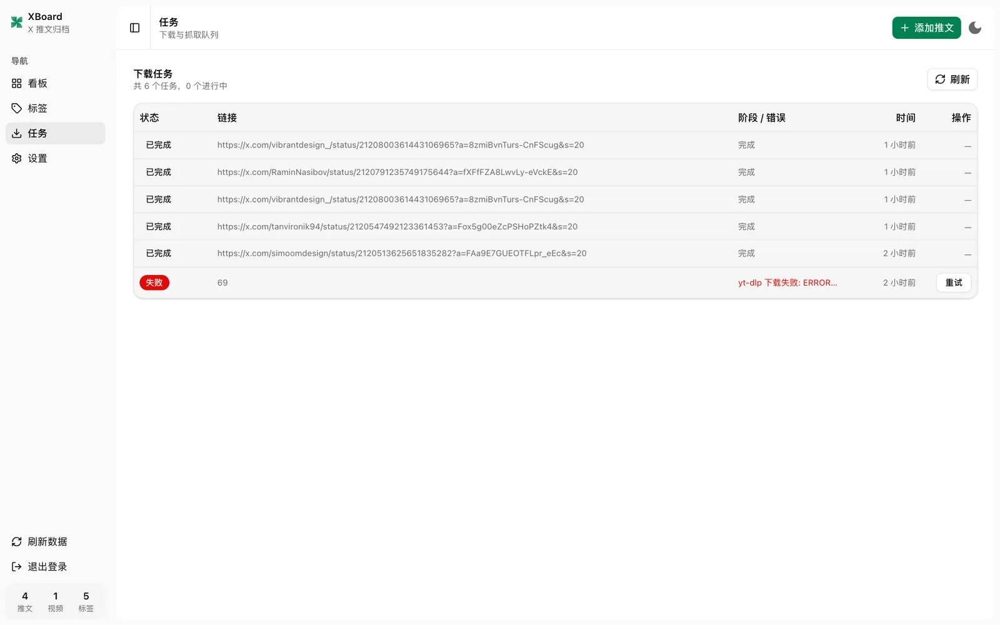
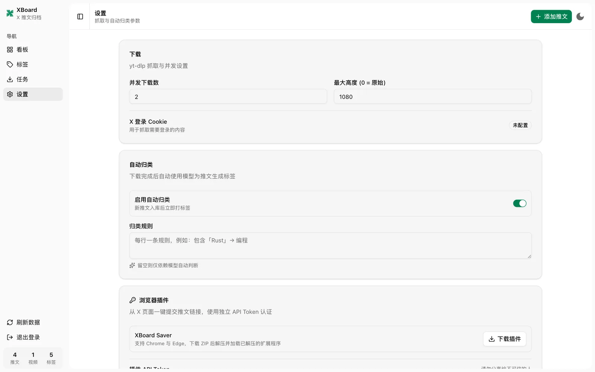
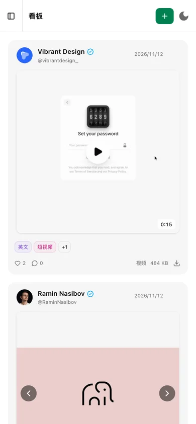

# XBoard



自托管的 X（Twitter）推文归档看板：粘贴推文链接 → yt-dlp 下载视频 / 抓取原图 →
自动归类打标签 → 在网页里按标签、作者、媒体类型浏览。

- 单进程 FastAPI + SQLite，媒体默认落本地盘，可选 Cloudflare R2。
- 管理台带登录（cookie 会话）+ 长期 API Token（浏览器插件 / 脚本）。
- 另有一份不含管理功能的公开只读页面，可单独部署。
- 浏览器插件（Chrome / Edge，Manifest V3）可在推文页一键入队。
- 镜像多架构（`linux/amd64` + `linux/arm64`），由 GitHub Actions 构建并发布到 GHCR。

更多背景文档：[DOCKER-DEPLOY.md](DOCKER-DEPLOY.md)（容器、反向代理、搬数据）、
[R2-MIGRATION.md](R2-MIGRATION.md)（历史媒体迁移到 R2）。

## 截图

| 看板（浅色） | 看板（深色） |
| --- | --- |
|  |  |

| 推文详情 | 分类管理 |
| --- | --- |
|  |  |

| 任务队列 | 设置 |
| --- | --- |
|  |  |

移动端（390×844）：

## 部署

三种方式任选：Docker（推荐给服务器）、本机直跑（开发/单机）、只跑前端（改 UI）。

### 方式一：Docker Compose（预构建镜像）

`.github/workflows/docker.yml` 在推送 `main`/`master`、推送 `v*` 标签或手动触发时，
先跑后端测试 + 镜像冒烟检查，再把镜像发布到 `ghcr.io/<owner>/<repository>`：

| 触发 | 标签 |
| --- | --- |
| 默认分支推送 | `latest` + `sha-<commit>` |
| 其他分支推送 | 分支名 + `sha-<commit>` |
| `v1.2.3` 标签 | `1.2.3` + `sha-<commit>` |
| Pull Request | 只测试构建，不推送 |

仓库公开后镜像也公开，可匿名拉取；若包仍是私有，需 `docker login ghcr.io`
（PAT 带 `read:packages`）。服务器上只需要 `compose.yaml`、`.env`、`data/`、`config/`：

```bash
git clone https://github.com/<owner>/<repository>.git /srv/xboard && cd /srv/xboard
cp .env.example .env          # 把 XBOARD_IMAGE 改成 ghcr.io/<owner>/<repository>:latest（小写）
sudo install -d -o 10001 -g 10001 -m 700 data config
docker compose pull api
docker compose up -d --no-build api
curl --fail http://127.0.0.1:8765/healthz
```

- 容器以 UID `10001` 运行，`data/` 与 `config/` 必须可写且**不要**用 root 归属。
- 不想拉镜像：`docker compose up -d --build`（本地构建，需 Docker BuildKit）。
- 升级：改 `.env` 里的 tag 或 `docker compose pull api && docker compose up -d --no-build api`。
- 镜像内含 Python 3.12、ffmpeg、yt-dlp、已构建的前端，以及 R2 需要的 boto3。
- 默认只绑定 `127.0.0.1`（`XBOARD_BIND_IP` / `XBOARD_PORT` 可改），对外请走 Nginx / Caddy / Cloudflare Tunnel。
- 反向代理、搬迁已有数据、公开前端分离部署见 [DOCKER-DEPLOY.md](DOCKER-DEPLOY.md)。

#### 飞牛 NAS（fnOS）安装

fnOS 基于 Debian 12，「Docker」是一等公民（应用中心安装），直接用 **项目（Compose）**
粘贴下面的配置即可，无需 SSH 构建。

1. **建共享文件夹**：文件管理里新建 `xboard`（例如挂在存储空间 1 下，
   真实路径形如 `/vol1/1000/xboard`，以你 NAS 的编号为准），并在里面建两个子目录
   `data`、`config`。

2. **给容器用户授权**：镜像内以 UID `10001` 运行，目录属主不对会在启动时报
   `Permission denied`。用 fnOS 的终端/SSH 执行：

   ```bash
   sudo chown -R 10001:10001 /vol1/1000/xboard
   ```

3. **新建项目**：应用中心 → Docker → **项目 → 新增**，名称填 `xboard`，
   路径选 `/vol1/1000/xboard`，粘贴下面内容后点「构建」（或「部署」）：

   ```yaml
   services:
     xboard:
       image: ghcr.io/helson-lin/xboard:latest
       container_name: xboard
       restart: unless-stopped
       ports:
         - "8765:8765"
       environment:
         PORT: "8765"
         XBOARD_DATA_DIR: /var/lib/xboard
         XBOARD_CONFIG_DIR: /etc/xboard
       volumes:
         - /vol1/1000/xboard/data:/var/lib/xboard
         - /vol1/1000/xboard/config:/etc/xboard
       stop_grace_period: 2m
   ```

   > 端口用 `"8765:8765"`（绑定 `0.0.0.0`）才能在局域网访问；
   > 只想反代访问可改成 `"127.0.0.1:8765:8765"`。

4. **取初始密码**：容器启动后看日志（Docker → 容器 → `xboard` → 日志），
   首次会打印管理员密码与 API Token，只打印一次。

5. **访问**：`http://<NAS内网IP>:8765/admin`；公开只读页是 `http://<NAS内网IP>:8765/`。

注意事项：

- 更新：Docker → 项目 → `xboard` → 编辑，把 `latest` 换成新 tag 或保留 `latest`
  后「拉取镜像 → 重新部署」；数据在共享文件夹里，重建容器不丢。
- 外网访问：fnOS 的 **FN Connect / 远程访问** 给 8765 开一条入口，或按
  [DOCKER-DEPLOY.md](DOCKER-DEPLOY.md) 用 Cloudflare Tunnel / 反代；**不要**把
  8765 直接暴露到公网。
- 备份：直接打包共享文件夹里的 `data/`（含 `xboard.db` 与媒体）和 `config/`。
- 想用 R2 而不是 NAS 本地盘：把 `config/storage.json` 放进共享文件夹的 `config/`，
  见下文「存储后端」。
- 若 Docker 应用拉取 GHCR 失败：在 Docker → 仓库/注册表里添加 `ghcr.io` 凭据
  （GitHub 用户名 + 带 `read:packages` 的 PAT），或改用 `docker login` 后重试。

### 方式二：本机直接运行

依赖：Python 3.10+（推荐 3.12）、ffmpeg、Node 22+（仅构建前端用）。

```bash
python3 -m venv .venv && . .venv/bin/activate
pip install -r requirements.txt      # FastAPI / uvicorn / yt-dlp / boto3
./build.sh                           # 安装前端依赖 → 构建 → 部署到 static/
./run.sh                             # 默认 8765，PORT=9000 ./run.sh 可改
```

打开 `http://localhost:8765/admin` 进入管理台，`http://localhost:8765/`
是公开只读页面。前端是构建产物，改完 `web/src` 必须重跑 `./build.sh` 再刷新。

### 方式三：只跑前端开发

```bash
cd web && npm install && npm run dev   # http://127.0.0.1:5173，/api 自动代理到 8765
```

`npm run build` 产物在 `web/dist`；`./build.sh` 会把它同步到 `static/`。

### 首次登录与凭据

首次启动且没有 `config/auth.json` 时，程序会生成随机密码并**打印到日志一次**：

```bash
docker compose logs api | head -20      # 或直接看本机启动输出
```

- 登录名默认 `admin`，密码以 PBKDF2-SHA256（26 万轮）哈希存 `config/auth.json`。
- 用环境变量接管：`XBOARD_USERNAME` / `XBOARD_PASSWORD`（优先生效，不落盘）。
- 插件和脚本用的长期 Token 存 `config/api_token.json`；丢失或泄露可在
  「设置 → 浏览器插件」查看/轮换（插件 API Token），或 `POST /api/auth/token/rotate`。
- 这些文件都在 `.gitignore` 里，**不要**提交或贴到 issue。

## 使用

1. 管理台右上角 **＋ 添加推文**，粘贴一条或多条链接，每行一个：
   - `https://x.com/SpaceX/status/1481651037291225113`
   - `https://twitter.com/NASA/status/755762873331089410`
2. **任务** 里看进度（排队 / 下载 / 转码 / 归类），失败可单条重试。
3. 下载完成后自动归类，标签出现在顶部 **分类栏**，点一下筛选。
4. 点卡片打开详情：内嵌播放器、图片画廊、备注、手动标签、重新归类、删除。
5. 快捷键：`/` 聚焦搜索，`Esc` 关闭弹窗。

支持的内容类型：

| 类型 | 处理方式 |
| --- | --- |
| 含视频推文 | yt-dlp 下载（ffmpeg 合并音视频），另存封面 |
| 纯图文推文 | 走公开元数据接口抓原图，单条最多 8 张 |
| 视频 + 图片 | 两者都下，标记为 `视频+图片` |
| 纯文字推文 | 只存文本，标记为 `纯文字` |

## 配置

### 环境变量

| 变量 | 默认 | 说明 |
| --- | --- | --- |
| `PORT` | `8765` | 监听端口 |
| `XBOARD_DATA_DIR` | `./data` | SQLite、媒体、任务数据 |
| `XBOARD_CONFIG_DIR` | `./config` | 凭据、设置、规则、cookies |
| `XBOARD_USERNAME` | `admin` | 登录名（与密码一起设置时覆盖 `auth.json`） |
| `XBOARD_PASSWORD` | 首次随机生成 | 登录密码（不落盘） |
| `XBOARD_API_TOKEN` | 首次随机生成 | 插件/脚本用的 Bearer Token |
| `XBOARD_STORAGE_CONFIG` | `$XBOARD_CONFIG_DIR/storage.json` | 存储配置文件路径 |
| `XBOARD_STORAGE_BACKEND` | `local` | `local` 或 `r2` |
| `XBOARD_STORAGE_ENDPOINT` | — | R2 的 `https://<account>.r2.cloudflarestorage.com` |
| `XBOARD_STORAGE_BUCKET` | — | R2 桶名 |
| `XBOARD_STORAGE_ACCESS_KEY_ID` / `_SECRET_ACCESS_KEY` | — | R2 S3 密钥 |
| `XBOARD_STORAGE_PREFIX` | `xboard` | 对象前缀 |
| `VITE_PUBLIC_API_BASE_URL` | 空（同源） | **构建期**变量，公开前端指向远端 API 时设置 |

### 存储后端：本地（默认）或 R2（可选）

**R2 不是必需的。** 不配置任何存储项时走 `local`：媒体写入 `data/media/`，
由 `/media/` 直接托管，数据库只存相对路径。

需要对象存储（多机、CDN、公开前端分离）时再开 R2。复制
`config/storage.example.json` → `config/storage.json`（`chmod 600`）并填：

```json
{
  "backend": "r2",
  "endpoint": "https://<ACCOUNT_ID>.r2.cloudflarestorage.com",
  "bucket": "<BUCKET>",
  "access_key_id": "<KEY>",
  "secret_access_key": "<SECRET>",
  "prefix": "xboard",
  "url_ttl": 3600
}
```

- 等价于环境变量 `XBOARD_STORAGE_*`，环境变量优先。
- 数据库里存 `r2://` 引用，签发的下载 URL 只临时使用，不落库。
- 从本地切到 R2 且要搬历史媒体：`python3 migrate_r2.py`（预览）→ `--apply`
  （上传并更新数据库，保留本地原文件）→ `--verify` 复核。细节见 [R2-MIGRATION.md](R2-MIGRATION.md)。
- 回退到 `local` 只需把 `backend` 改回 `local`，本地原文件仍在。

### `config/settings.json`（也可在「设置」页面改）

| 键 | 默认 | 说明 |
| --- | --- | --- |
| `max_height` | `1080` | 视频分辨率上限（0 = 原始） |
| `concurrent_downloads` | `2` | 并发下载数（SQLite + 单进程，不建议很大） |
| `auto_tag` | `true` | 下载后是否自动归类 |
| `max_auto_tags` | `6` | 每篇最多几个分类标签 |
| `write_thumbnail` | `true` | 是否保留封面图 |
| `keep_ytdlp_json` | `true` | 是否保留 yt-dlp 原始元数据 |

### `config/tag_rules.json` 与自动归类

可在「设置 → 分类关键词规则」里直接编辑保存，立即生效，无需重启。三层信号：

1. **分类关键词**（权重 10+）：内置 24 个分类，如 `AI`、`科技`、`太空`、`财经`、
   `加密货币`、`游戏`、`影视`、`音乐`、`体育`、`搞笑`、`时事`、`政治`、`军事`、`科学`、
   `健康`、`美食`、`旅行`、`汽车`、`动物`、`设计`、`教程`、`职场`、`教育`、`购物`
2. **作者话题标签**（权重 5）：推文里的 `#xxx` 直接成为标签
3. **语言与媒体形态**（权重 2–3）：`中文`/`英文`、`视频`/`图片`/`纯文字`、
   `短视频`/`长视频`、`1080P`/`4K`

英文关键词按词边界匹配，避免 `ai` 误命中 `said`。改完规则可点
**重新归类全部** 批量重算，手动标签不会被覆盖。

### 受限推文 / cookies

公开推文无需登录。遇到敏感或年龄限制内容时，把 Netscape 格式 cookies 导出到
`config/cookies.txt`（容器内 `/etc/xboard/cookies.txt`），保存后自动生效，
设置页会显示检测状态。

## 浏览器插件

管理台「设置 → 浏览器插件」下载 ZIP，解压后按 `extension/README.txt`：
Chrome `chrome://extensions` / Edge `edge://extensions` → 开启开发者模式 →
加载已解压的扩展程序。插件里填 XBoard 地址和 **API Token** 即可在推文页一键入队
或右键「保存到 XBoard」。源码在 `extension/`。

## 公开只读页面与 API

- `/` 公开只读页面（无管理功能），`/admin` 管理台。
- `/public/*`、`/media/*` 允许匿名 **GET/HEAD**（带按 IP 的限流与缓存头）；
  其余 `/api/*` 需要登录 cookie 或 `Authorization: Bearer <API_TOKEN>`。
- 想把公开前端放到别的域名（如 Cloudflare Pages）：构建时设
  `VITE_PUBLIC_API_BASE_URL=https://api.example.com`，见 [DOCKER-DEPLOY.md](DOCKER-DEPLOY.md)。
- `/healthz` 只返回 `{"ok":true}`，用于探活，不泄露数据。

## 安全与备份

- 登录为无状态 HMAC 会话 cookie（7 天），`/docs`、`/openapi.json` 已在生产关闭。
- 需要保密的内容只有 `config/` 下的 `auth.json`、`api_token.json`、`secret.key`、
  `settings.json`、`storage.json`、`cookies.txt`；仓库 `.gitignore` 已全部排除。
  GitHub Actions 只用内置 `GITHUB_TOKEN` 推镜像，**不需要**提供 R2 密钥。
- 备份：停服或 `docker compose stop api` 后打包 `data/`（含 `xboard.db` 与媒体）
  和 `config/`；SQLite 使用 WAL，热备请用 `sqlite3 data/xboard.db ".backup ..."`。
- 升级：镜像换 tag → `docker compose up -d --no-build api`；数据库结构由程序启动时自行迁移。

## 目录结构

```text
xboard/
├── app.py                 FastAPI 路由与鉴权中间件
├── run.sh / build.sh      启动 / 构建并部署前端
├── migrate_r2.py          本地 ↔ R2 媒体迁移（预览 / --apply / --verify）
├── core/
│   ├── config.py          路径、默认设置
│   ├── db.py              SQLite 存储
│   ├── auth.py            密码哈希、会话、API Token
│   ├── storage.py         本地 / R2 媒体存储
│   ├── downloader.py      元数据抓取 + yt-dlp 下载
│   ├── tagger.py          自动归类引擎
│   ├── jobs.py            后台任务流水线
│   └── ratelimit.py       公开接口限流与缓存
├── web/                   前端（Vite + React 19 + TS + Tailwind v4）
│   ├── src/components/ui/     Watermelon UI 组件（agndex-dashboard registry）
│   ├── src/components/board/  卡片、详情、筛选、添加对话框
│   ├── src/components/layout/ 侧边栏、顶栏
│   ├── src/pages/             看板 / 标签 / 任务 / 设置
│   └── src/public/            公开只读页面
├── extension/             浏览器插件（Manifest V3）
├── static/                构建产物（app.py 托管）
├── docker/entrypoint.sh   容器启动脚本
├── tests/                 后端离线测试
├── config/                auth / token / settings / rules / storage / cookies
└── data/                  xboard.db + media/<推文ID>/
```

## 开发与测试

```bash
cd web && npm run lint                      # oxlint
python3 -m unittest discover -s tests -v     # 后端离线测试
npx markdownlint-cli2 "*.md"                 # 文档格式（.markdownlint.json）
```

不依赖外网的测试都在 `tests/`；`test_r2.py` 用假的 S3 客户端，不会碰真实桶。

## 持续集成

`.github/workflows/docker.yml`：后端测试 → 构建镜像（`linux/amd64` 冒烟）→
起容器验证 `/healthz`、`/public/posts`、`/admin`、插件包下载、ffmpeg、yt-dlp、
非 root 用户 → 发布多架构清单（`linux/amd64` + `linux/arm64`）到 GHCR。
PR 只测试不推送，无需配置任何 secrets。

## 已知限制

- **不从时间线批量抓取**：X 的时间线接口需要登录且反爬严格，本看板按链接逐条下载；
  批量请一次性粘贴多条链接。
- 单进程设计（SQLite + 进程内任务队列 + 内存限流）：不要横向扩多副本，
  `uvicorn --workers` 必须保持 1。
- 元数据来自 X 的公开接口，字段可能随平台调整而变；接口失效时下载会失败并在任务页报错。
- 前端是构建产物：改源码后不重跑 `./build.sh`（或重建镜像）页面不会变。

## 许可证

[MIT](LICENSE) © 2026 JarinHe
